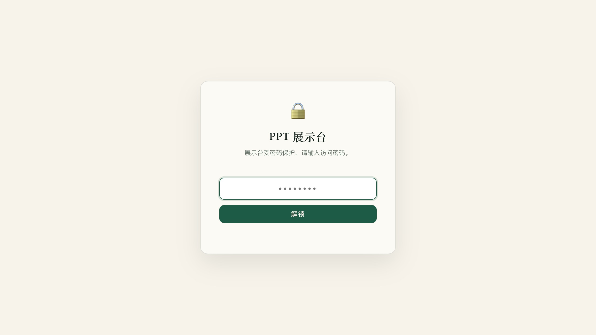
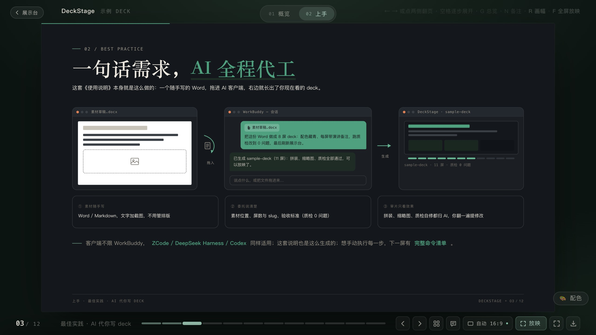
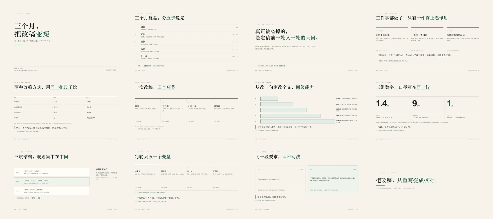

# DeckStage · HTML 幻灯片展示台

**English** · A static-first HTML slide platform: authored decks in plain HTML/CSS, external
`.pptx` files imported by an automated LibreOffice-based pipeline (render → text-repair overlay →
assemble), a deck library with thumbnails, fullscreen presenting, speaker notes, and in-page
PPTX export. Chinese UI, zero frontend build dependencies. License: Apache-2.0.

---

一个多套 PPT 的展示台：首页缩略图墙 → 点开任意一套放映 · 16:9 / 4:3 自适应 · 放映模式 / 动画 / 备注 / 导出 PPTX · 外部 PPTX 经自动 pipeline 一键导入。

> **设计原则：引擎与内容分离。** 仓库里只有引擎和一套匿名示例 deck；你的真实汇报内容放在本地、
> 永不进入版本库 —— 部署（站点直接服务本地目录）与开源互不干扰。

## 一、这是什么

| 能力 | 说明 |
|---|---|
| **HTML 创作** | 一屏一个 HTML 文件，类名体系见 [docs/AUTHORING.md](docs/AUTHORING.md)；`reveal` 入场动效、数字滚动、演讲备注、导轨分章 |
| **版式骨架** | 12 个可直接抄的页面骨架 + 选型 / 反单调规则，见 [LAYOUTS.md](capabilities/design-quality/LAYOUTS.md)；画廊 `src-archetypes/`，多样性检查 `layout_audit.py` |
| **PPTX 导入** | 外部 PowerPoint 经六阶段 pipeline 自动转换（体检 → 字体 → 版式预修 → LibreOffice 渲染 → 补字层 → 组装），详见 [docs/IMPORT.md](docs/IMPORT.md) |
| **展示台** | `library.html` 缩略图墙聚合所有 deck；`serve_deck.py` 本地起服务后右上角可「＋ 导入 PPTX」（四步向导，仅限本机） |
| **管理后台** | `/admin/` 支持访客分析、首页与 deck 门禁、内容上下架、分享链接与二维码卡片。详见 [管理后台](docs/ADMIN.md) |
| **放映** | `F` 全屏、`→/←` 翻页、`G` 总览、`N` 备注、`R` 画幅切换、`C` 配色主题（七套预设含素白与深色，见 [docs/DECK_SPEC.md](docs/DECK_SPEC.md)）、`#s12` 深链 |
| **导出** | 页面内导出可编辑 PPTX，保留纯色背景与内联 SVG 的透明度。构建也可产出全内联的单机版 HTML。详见 [PPTX 导出](docs/PPTX.md) |
| **质检** | 检查表达、版面、视觉对比度与 PPTX 导出，支持放映交互自测和逐屏截图 |

`build.mjs` 使用 Node 标准库拼装，通过 Python 运行写作检查和缩略图工具。浏览器端依赖随仓库提供。

v1.4.0 的变更详见 [发布日志](CHANGELOG.md#140---2026-11-20)。

## 二、快速开始

```bash
# 0) 安装 Python 工具链、DSH 写作能力和 frame 命令
python3 -m venv .venv
source .venv/bin/activate
./install.sh

#    依赖已就绪，单独安装写作能力：./install.sh --no-deps
#    只安装 Python 工具链：python3 -m pip install -r requirements.txt

# 1) 拼装示例 deck 并起展示台
#    sample-deck 是 12 屏《使用说明》：安装 / 最佳实践 / 放映 / 配色 / 创作 / 导入 / 管理
node build.mjs --src src-sample --deck sample-deck
python3 tools/serve_deck.py               # → http://127.0.0.1:8899/

# 2) 导入你自己的 PPTX（二选一）
#    UI：展示台右上角「＋ 导入 PPTX」→ 四步向导
#    CLI：
python3 tools/import_pptx.py 你的.pptx --slug my-deck --dry-run   # 先体检
python3 tools/import_pptx.py 你的.pptx --slug my-deck             # 正式导入

# 3) 写自己的 deck：先选页面骨架，再一屏一个文件
node build.mjs --src src-archetypes --deck archetypes   # 12 个骨架的画廊，先看再抄
node build.mjs --src src-mine --deck my-deck
```

运行需要 Node 18+、Python 3.9+。缩略图和浏览器质检需要 Chrome，PPTX 导入需要 LibreOffice。
构建会尝试刷新缩略图和展示台。服务启动后可运行 `python3 tools/build_library.py --deck sample-deck` 重拍封面。

### 使用图例

**展示台**（`serve_deck.py` 起服务后的首页）：所有 deck 的缩略图墙，点卡片即放映。



**deck 放映**：示例 deck 第 3 屏「最佳实践」——顶部导轨分章、底部进度条与快捷键提示；
按 `C` 或右下角「配色」按钮可整套换色，下图右为玄墨深色主题（详见 [docs/DECK_SPEC.md](docs/DECK_SPEC.md)）。




## 二·五、最佳实践：让 AI 替你写 deck

被验证最多的用法（示例 deck 第 3 屏是图文版）。安装也是一句话的事——把
`https://github.com/Rocky8080/deckstage` 发给 AI 客户端，让它克隆、装依赖、起服务，
浏览器能打开展示台就算完成（示例 deck 第 2 屏）；然后：

1. **素材随手写**：一个简单的 Word / Markdown，文字 + 截图随手放，不用管排版；
2. **一句话委托**：在 ZCode / WorkBuddy / DeepSeek Harness / Codex 等 AI 客户端里，
   把文件拖进去并说清三件事——素材位置、目标屏数与 slug、验收标准（如「质检 0 问题」）；
3. **审片只看效果**：AI 调用本仓库工具链完成拼装、缩略图、质检自修，你翻一遍提修改即可。
4. **先选骨架**：让 AI 先读 `capabilities/design-quality/LAYOUTS.md`，按「内容 → 骨架」列 8–12 屏清单
   （一套 ≥10 屏至少 6 种骨架、相邻不重复），再复制骨架填内容；画廊见 `decks/archetypes/`。

适用边界：内容型汇报最适合这条路；需要严格品牌版式 / 合规模板时，走 PPTX 导入保真路径。

## 二·六、版式骨架库（v1.4.0）



12 个可直接抄的页面骨架：封面 / 目录 / 单观点 / 三并列 / 对照矩阵 / 过程链 / 阶梯 / 数据看板 / 分层架构 / 闭环 / 反例正例 / 收尾。每个都带适用信号、容量上限和反例，选型与反单调规则见 [LAYOUTS.md](capabilities/design-quality/LAYOUTS.md)。

```bash
node build.mjs --src src-archetypes --deck archetypes   # 12 屏画廊
python3 tools/layout_audit.py --index decks/<slug>/index.html   # 骨架种数 / 相邻重复
```

## 三、目录

```
build.mjs                  拼装器：src-*/slides/*.html + shell → 单文件 index.html / decks/<slug>/
import.html                PPTX 导入向导（配合 serve_deck.py 的 /api/*，仅限本机）
library.html               展示台（build_library.py 生成）
src/css/                   设计变量 tokens.css + 基础排版 base.css + 放映外壳 deck.css（引擎）
src/js/                    放映引擎 deck.js + 页面内 PPTX 导出 pptx-export.js（引擎）
src-sample/                示例 deck 源码（shell + slides），创作模板
src-archetypes/            12 个页面骨架的画廊源码（slides 为符号链接，实际文件在 capabilities/design-quality/archetypes/）
decks/<slug>/              成品：index.html + deck.json + thumb.jpg（sample-deck 已含）
assets/<slug>/             导入 deck 的逐页渲染图
tools/                     全部工具链（见 docs/IMPORT.md、docs/ADMIN.md、各文件 docstring）
  import_pptx.py             PPTX → deck 六阶段 pipeline（单命令入口）
  serve_deck.py              静态服务 + 导入 API（仅限本机）+ /admin 管理后台（追踪 / 门禁 / 上下架）
  admin_core.py              管理后台数据层：管理员会话 / 门禁配置 / SQLite 访问统计
  admin_site.py              管理后台页面、追踪脚本、门禁页模板
  build_library.py           展示台聚合：缩略图 / decks.json / library.html
  pptx_*.py                  渲染前的版式预修工具链（nowrap / 缩字 / prefit / 字距…）
  check_slides.py            溢出 / 截断 / 重叠 / 图片 / 控制台报错体检
  test_deck.py               放映交互自测
  frame.py                  表达检查与写作框架
  design_audit.py            文字对比度与强调色面积检查
  layout_audit.py            页面骨架覆盖与重复检查（版式多样性）
  export_audit.py            PPTX 背景与页数核验
capabilities/              写作与视觉检查规则、提示词、12 个页面骨架（design-quality/archetypes）
docs/                      AUTHORING / DECK_SPEC / IMPORT / ADMIN / DESIGN / PPTX
vendor/                    pptxgen.bundle.js（MIT，落盘锁定）
```

约定：**你的真实 deck 内容放哪都不入库**。本仓库的 `.gitignore` 默认排除
`decks/`、`assets/`、`src/slides`、`src/shell.html`、`exports/`、`docs/本地笔记/` 下除示例以外的全部内容
（仓库只跟踪 `*/sample-deck` 与引擎）——想公开某套 deck 时自行调整白名单。

## 四、质检

```bash
node build.mjs --src src-sample --deck sample-deck
python3 tools/test_deck.py                           # 对根 index.html 做放映交互自测
python3 tools/frame.py audit "src-sample/slides/*.html"

# 启动 python3 tools/serve_deck.py 后运行
python3 tools/check_slides.py --index decks/sample-deck/index.html
python3 tools/design_audit.py --index decks/sample-deck/index.html
python3 tools/design_audit.py --index decks/sample-deck/index.html --ratio 4:3
python3 tools/layout_audit.py --index decks/sample-deck/index.html
python3 tools/export_audit.py --index decks/sample-deck/index.html
```

## 五、安全模型

导入 API 永远不应该暴露到公网：`serve_deck.py` 的导入路由（`/api/inventory|import|cancel|publish`）
校验 `Host` 头，仅接受 `127.0.0.1 / localhost` 直连；经反向代理（如 cloudflared tunnel）而来的公网请求
Host 是站点域名，一律 403。请勿修改或绕过该守卫后再绑定公网。

其余 API 属于另一边界：`/api/track/*`（匿名访问统计）、`/api/access`（deck 门禁密码）
与 `/api/admin/*`（管理后台，密码登录 + 登录限流）设计上可经隧道公网使用；
追踪记录包含浏览器随机访客 ID、IP、客户端、来源和停留数据。服务端将记录保存到 `data/`，该目录由 Git 忽略。

## 六、授权

- **代码**：[Apache-2.0](LICENSE)
- **示例 deck 内容**（`src-sample/`、`decks/sample-deck/`、`docs/`）：与仓库同授权
- **你创作的内容**：归你所有，仓库约定默认不入库
- 第三方组件：`vendor/pptxgen.bundle.js`（[pptxgenjs](https://github.com/gitbrent/PptxGenJS)，MIT）

## English notes

`serve_deck.py` serves any directory as the site root and embeds the import API used by
`import.html`. The six-stage import pipeline (`tools/import_pptx.py`) normalizes fonts,
pre-fits layouts, renders pages headlessly via LibreOffice, repairs unrendered/tofu text as a
coordinate-accurate HTML overlay, and assembles a self-contained deck. See
[docs/IMPORT.md](docs/IMPORT.md) for the validated recipe and knobs. It also ships an
admin console at `/admin/` with visitor analytics, password gates for the library and
individual decks, publish controls, and downloadable QR share cards. See [docs/ADMIN.md](docs/ADMIN.md).
Issues and PRs welcome — please keep personal content out of PRs (the default `.gitignore`
already guards this).

## 写作能力包：因果链 / 价值链

使用 `frame framework` 查看写作方法，`frame audit <路径>` 审查页面，`frame lint "<句子>"` 检查文案。
也可在仓库直接运行 `python3 tools/frame.py` 加同样的参数。
构建默认调用写作检查，遇到 P0 表达问题时停止。详见 [创作规范](docs/AUTHORING.md) 与 [AGENTS.md](AGENTS.md)。

`./install.sh` 安装 DSH 技能、合并用户级写作规则，并将 `frame` 链到 `~/.local/bin`。
运行 `./install.sh --check` 可检查安装状态。其他工作区可按需安装写作规则。详见 [写作能力包](capabilities/causal-value-chain/README.md)。
