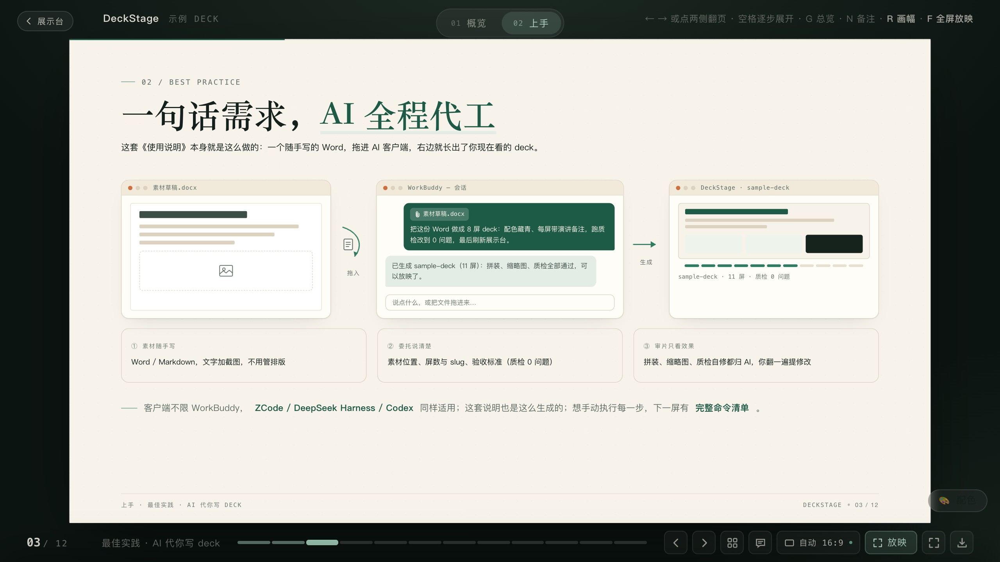

# DeckStage · HTML 幻灯片展示台

**English** · A static-first HTML slide platform: authored decks in plain HTML/CSS, external
`.pptx` files imported by an automated LibreOffice-based pipeline (render → text-repair overlay →
assemble), a deck library with thumbnails, fullscreen presenting, speaker notes, and in-page
PPTX export. Chinese UI, zero frontend build dependencies. License: Apache-2.0.

---

一个多套 PPT 的展示台：首页缩略图墙 → 点开任意一套放映 · 16:9 / 4:3 自适应 · 放映模式 / 动画 / 备注 / 导出 PPTX · 外部 PPTX 经自动 pipeline 一键导入。

> **设计原则：引擎与内容分离。** 仓库里只有引擎和一套匿名示例 deck；你的真实汇报内容放在本地、
> 永不进入版本库 —— 部署（站点直接服务本地目录）与开源互不干扰。

## 一、这是什么

| 能力 | 说明 |
|---|---|
| **HTML 创作** | 一屏一个 HTML 文件，类名体系见 [docs/AUTHORING.md](docs/AUTHORING.md)；`reveal` 入场动效、数字滚动、演讲备注、导轨分章 |
| **PPTX 导入** | 外部 PowerPoint 经六阶段 pipeline 自动转换（体检 → 字体 → 版式预修 → LibreOffice 渲染 → 补字层 → 组装），详见 [docs/IMPORT.md](docs/IMPORT.md) |
| **展示台** | `library.html` 缩略图墙聚合所有 deck；`serve_deck.py` 本地起服务后右上角可「＋ 导入 PPTX」（四步向导，仅限本机） |
| **管理后台** | `/admin/` 访问追踪（逐屏时长 / 来源 / 访客）· deck 密码门禁与上下架（即时生效），见 [docs/ADMIN.md](docs/ADMIN.md) 与 [CHANGELOG.md](CHANGELOG.md) |
| **放映** | `F` 全屏、`→/←` 翻页、`G` 总览、`N` 备注、`R` 画幅切换、`C` 配色主题（六套预设含深色，见 [docs/DECK_SPEC.md](docs/DECK_SPEC.md)）、`#s12` 深链 |
| **导出** | 页面内一键导出可编辑 PPTX（pptxgenjs）；构建时可产出全内联的单机版 HTML |
| **QA 工具** | 溢出/截断/重叠检查、放映交互自测、逐屏截图（见下文「质检」） |

零前端构建依赖：`build.mjs` 只用 Node 标准库；第三方运行时落盘在 `vendor/`（离线可用，不依赖 CDN）。

## 二、快速开始

```bash
# 0) 依赖：Node ≥ 18（拼装）；放映与创作到此为止，浏览器打开即可。
#    PPTX 导入另需：LibreOffice + Python 3.9+ 工具链：
pip install -r requirements.txt

# 1) 拼装示例 deck 并起展示台
#    sample-deck 是 12 屏《使用说明》：安装 / 最佳实践 / 放映 / 配色 / 创作 / 导入 / 管理
node build.mjs --src src-sample --deck sample-deck
python3 tools/build_library.py            # 生成 decks.json / library.html / 缩略图
python3 tools/serve_deck.py               # → http://127.0.0.1:8899/

# 2) 导入你自己的 PPTX（二选一）
#    UI：展示台右上角「＋ 导入 PPTX」→ 四步向导
#    CLI：
python3 tools/import_pptx.py 你的.pptx --slug my-deck --dry-run   # 先体检
python3 tools/import_pptx.py 你的.pptx --slug my-deck             # 正式导入

# 3) 写自己的 deck：抄 src-sample/ 的结构，一屏一个文件
node build.mjs --src src-mine --deck my-deck
```

> 缩略图 / QA 需要 Chrome（Playwright 走 `channel="chrome"`）；PPTX 渲染需要 LibreOffice。

### 使用图例

**展示台**（`serve_deck.py` 起服务后的首页）：所有 deck 的缩略图墙，点卡片即放映。


**deck 放映**：示例 deck 第 3 屏「最佳实践」——顶部导轨分章、底部进度条与快捷键提示；
按 `C` 或右下角「配色」按钮可整套换色，下图右为玄墨深色主题（详见 [docs/DECK_SPEC.md](docs/DECK_SPEC.md)）。




## 二·五、最佳实践：让 AI 替你写 deck

被验证最多的用法（示例 deck 第 3 屏是图文版）。安装也是一句话的事——把
`https://github.com/Rocky8080/deckstage` 发给 AI 客户端，让它克隆、装依赖、起服务，
浏览器能打开展示台就算完成（示例 deck 第 2 屏）；然后：

1. **素材随手写**：一个简单的 Word / Markdown，文字 + 截图随手放，不用管排版；
2. **一句话委托**：在 ZCode / WorkBuddy / DeepSeek Harness / Codex 等 AI 客户端里，
   把文件拖进去并说清三件事——素材位置、目标屏数与 slug、验收标准（如「质检 0 问题」）；
3. **审片只看效果**：AI 调用本仓库工具链完成拼装、缩略图、质检自修，你翻一遍提修改即可。

适用边界：内容型汇报最适合这条路；需要严格品牌版式 / 合规模板时，走 PPTX 导入保真路径。

## 三、目录

```
build.mjs                  拼装器：src-*/slides/*.html + shell → 单文件 index.html / decks/<slug>/
import.html                PPTX 导入向导（配合 serve_deck.py 的 /api/*，仅限本机）
library.html               展示台（build_library.py 生成）
src/css/                   设计变量 tokens.css + 基础排版 base.css + 放映外壳 deck.css（引擎）
src/js/                    放映引擎 deck.js + 页面内 PPTX 导出 pptx-export.js（引擎）
src-sample/                示例 deck 源码（shell + slides），创作模板
decks/<slug>/              成品：index.html + deck.json + thumb.jpg（sample-deck 已含）
assets/<slug>/             导入 deck 的逐页渲染图
tools/                     全部工具链（见 docs/IMPORT.md、docs/ADMIN.md、各文件 docstring）
  import_pptx.py             PPTX → deck 六阶段 pipeline（单命令入口）
  serve_deck.py              静态服务 + 导入 API（仅限本机）+ /admin 管理后台（追踪 / 门禁 / 上下架）
  admin_core.py              管理后台数据层：管理员会话 / 门禁配置 / SQLite 访问统计
  admin_site.py              管理后台页面、追踪脚本、门禁页模板
  build_library.py           展示台聚合：缩略图 / decks.json / library.html
  pptx_*.py                  渲染前的版式预修工具链（nowrap / 缩字 / prefit / 字距…）
  check_slides.py            溢出 / 截断 / 重叠 / 图片 / 控制台报错体检
  test_deck.py               放映交互自测
docs/                      AUTHORING（版式规范）/ DECK_SPEC（交互规范）/ IMPORT（导入）/ ADMIN（管理后台）
vendor/                    pptxgen.bundle.js（MIT，落盘锁定）
```

约定：**你的真实 deck 内容放哪都不入库**。本仓库的 `.gitignore` 默认排除
`decks/`、`assets/`、`src/slides`、`src/shell.html`、`docs/本地笔记/` 下除示例以外的全部内容
（仓库只跟踪 `*/sample-deck` 与引擎）——想公开某套 deck 时自行调整白名单。

## 四、质检

```bash
node build.mjs                                        # 拼装主树
python3 tools/check_slides.py --shots                 # 溢出/截断/重叠体检，截图在 /tmp/qa
python3 tools/test_deck.py                            # 放映交互自测
```

## 五、安全模型

导入 API 永远不应该暴露到公网：`serve_deck.py` 的导入路由（`/api/inventory|import|cancel|publish`）
校验 `Host` 头，仅接受 `127.0.0.1 / localhost` 直连；经反向代理（如 cloudflared tunnel）而来的公网请求
Host 是站点域名，一律 403。请勿修改或绕过该守卫后再绑定公网。

其余 API 属于另一边界：`/api/track/*`（匿名访问统计）、`/api/access`（deck 门禁密码）
与 `/api/admin/*`（管理后台，密码登录 + 登录限流）设计上可经隧道公网使用；
追踪数据只含随机 UUID，不含个人身份信息。运行时数据在 `data/`（不入库）。

## 六、授权

- **代码**：[Apache-2.0](LICENSE)
- **示例 deck 内容**（`src-sample/`、`decks/sample-deck/`、`docs/`）：与仓库同授权
- **你创作的内容**：归你所有，仓库约定默认不入库
- 第三方组件：`vendor/pptxgen.bundle.js`（[pptxgenjs](https://github.com/gitbrent/PptxGenJS)，MIT）

## English notes

`serve_deck.py` serves any directory as the site root and embeds the import API used by
`import.html`. The six-stage import pipeline (`tools/import_pptx.py`) normalizes fonts,
pre-fits layouts, renders pages headlessly via LibreOffice, repairs unrendered/tofu text as a
coordinate-accurate HTML overlay, and assembles a self-contained deck. See
[docs/IMPORT.md](docs/IMPORT.md) for the validated recipe and knobs. It also ships an
admin console at `/admin/` — anonymous visit tracking (per-slide dwell time), per-deck
password protection and publish/unpublish switches; see [docs/ADMIN.md](docs/ADMIN.md).
Issues and PRs welcome — please keep personal content out of PRs (the default `.gitignore`
already guards this).
